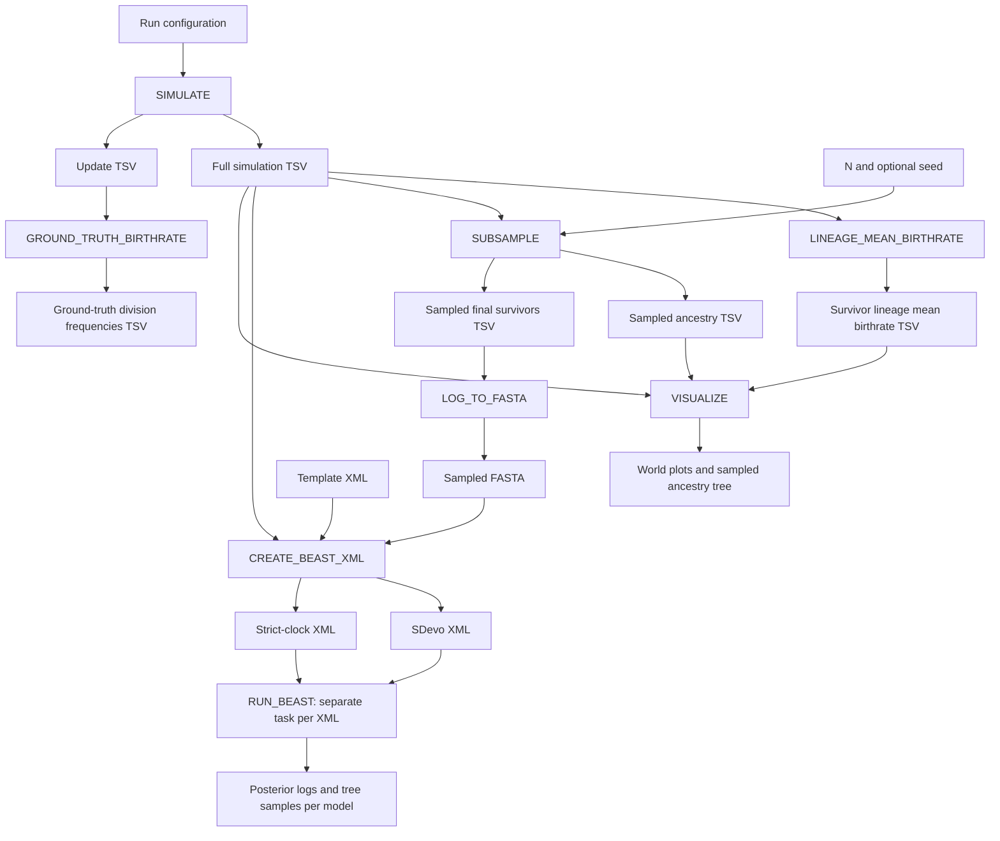

# Eden simulation workflow

`main.nf` implements `concept-DAG.png`: simulation, two birth-rate summaries,
subsampling, FASTA conversion, simulation visualizations, two BEAST XMLs, and
independent SDevo and strict-clock BEAST runs.

## Run

Use Nextflow 26.10 or later and an active Python environment with the packages
in `requirements.txt`. All executable Python scripts live in `bin/`, use
`#!/usr/bin/env python`, and are found through Nextflow's automatic `bin/` support.

```bash
python -m pip install -r requirements.txt
nextflow run main.nf
```

Put BEAST on `PATH`, or pass `--beast /path/to/beast`. The supplied XML uses the
BEAST 2.6 API. The full workflow was tested with BEAST 2.6.7, BDMM-Prime 0.0.30,
SDevo 0.0.2, SA 2.0.2, and BEASTLabs 1.9.7. See
[BEAST's package instructions](https://www.beast2.org/managing-packages/) for package management.

The default configurations come from `assets/eden_runs.json`. Each JSON object
runs independently and supplies the simulation parameters, including its relative
`log_file` name. The update-log filename follows `sim.py`'s naming convention,
or the explicit `update_log_file` setting if provided. Extinct simulations restart;
only the successful attempt's logs are retained.

```bash
nextflow run main.nf --runs path/to/runs.json --n 100 --seed 42 --outdir results
nextflow run main.nf -resume
```

`-resume` reuses completed Nextflow tasks; it does not continue an interrupted
MCMC chain. A BEAST task that must execute again starts a fresh chain.

| Parameter | Default | Meaning |
| --- | --- | --- |
| `--runs` | `assets/eden_runs.json` in the project | Simulation configurations |
| `--outdir` | `results/` in the launch directory | Published results |
| `--n` | `100` | Absolute number of final survivors to sample |
| `--seed` | `42` | Subsampling seed; `null` disables the fixed seed |
| `--template` | `assets/SDEVO_template.xml` in the project | Common model template |
| `--chain_length` | `5000000` | MCMC steps per model |
| `--log_every` | `1000` | MCMC logging interval |
| `--beast` | `beast` | BEAST executable |
| `--beast_seed` | `42` | Base MCMC seed; the run index is added |

## Data flow



All channels retain the numeric run index. Joins match on that index, so parallel
runs cannot pair one simulation's FASTA or rates with another simulation's log.

## Results

Each JSON entry publishes to its own `results/run_<index>/` directory:

```text
simulation/       configured lifetime and update TSV files
rates/            survivor_lineage_mean_birthrate.tsv
                  ground_truth_birthrate.tsv
subsample/        subsampled.tsv
                  subsampled_survivors.tsv
                  subsampled.fasta
visualizations/   world_states.png
                  world_lineage_mean_birthrate.png
                  sampled_tree.png, sampled_tree.svg, sampled_tree.nwk
xml/              sdevo.xml, strict_clock.xml
beast/sdevo/      sdevo.log, sdevo.trees, sdevo.typed.trees,
                  sdevo.typed.node.trees, and the MCMC state file
beast/strict_clock/ corresponding strict_clock.* files
```

`subsampled.tsv` contains the N selected survivors and all their ancestors;
`subsampled_survivors.tsv` contains exactly those N survivors. Only the latter
is converted to FASTA, so extinct ancestors are not treated as sampled taxa.
Tree visualizations use the sampled ancestry; world plots use all final survivors.

## Differences and fixes relative to the drawing

| Where | Difference | Why and how |
| --- | --- | --- |
| `CREATE_BEAST_XML` inputs in `main.nf` | Added the full simulation TSV and the template as inputs | FASTA alone cannot provide the full per-state survivor totals needed for sampling proportions, or the mutation counts and elapsed ticks used to calibrate the global clock. The FASTA channel is joined to its original log by run index; the template is a staged file input. |
| `VISUALIZE` inputs in `main.nf` | Added the full simulation TSV and sampled ancestry | The rates TSV has only cell IDs and rates, with no coordinates or parent relationships. The full log supplies final-world positions; the sampled ancestry supplies the tree. Both are joined to the corresponding rate file. |
| `CREATE_BEAST_XML` / `bin/create_beast_xml.py` | Defined how the strict-clock control is constructed | Both models share sequences, BDMM-Prime tree prior, sampling proportions, empirical fixed global clock, chain length, logging interval, and per-run seed. The strict model replaces `BdmmStateClock` with `StrictClockModel` and removes its state-clock-only attributes and embedded mapped tree. Birth rates remain estimated through the common BDMM-Prime prior. |
| `RUN_BEAST` | The two XMLs produce two independent tasks per simulation | A BEAST invocation runs one XML. The SDevo and strict-clock channels are tagged with their model names and combined into one process input channel; each task receives one XML. |
| `RUN_BEAST` outputs | Used BEAST's `<model>.typed.node.trees` naming and retained the other tree samples and state file | The drawing says `node.typed.trees`; the supplied template writes `typed.node.trees`. Keeping the native logger names avoids renaming or confusing the formats. Untyped trees, fully mapped trees, and MCMC state files are also published. |
| Process outputs / `publishDir` | Added per-run, per-stage, and per-model directories | Configurations can reuse filenames. Nextflow task directories isolate execution; publication paths prevent collisions. Downstream stages read channel outputs rather than asynchronously published files. |
| Tabular artifacts | Descendant simulation tables use `.tsv` rather than the drawing's generic `.log` | Their format remains tab-separated with the original columns. This separates simulation tables from BEAST posterior `.log` files. Configured original simulation filenames are preserved. |
| `bin/create_beast_xml.py` | Resolved committed merge markers and corrected the default template filename | The markers made the script invalid Python. The required explicit `--simulation-log` option is preserved with its clock-calibration behavior, and the default now points to the existing `assets/SDEVO_template.xml`. |
| `bin/sim.py`, `generate_strands()` | Corrected mutation-site indexing | Mutation IDs start at 1; sequence construction previously used `0..length-1`, adding an unused site and omitting the last mutation. Both loops now use `1..length`, so FASTA differences agree with logged mutations and clock calibration. |
| `bin/visualize_sim.py` | Added a headless visualization entry point | The existing visuals were notebook-driven. The script reuses the ancestry plotting functions and saves world PNGs, a tree PNG/SVG, and annotated Newick without a GUI. The tree time axis is explicitly logged simulation time, including final-snapshot bookkeeping. |
| `nextflow.config` | Made N, seeds, template, BEAST executable, and MCMC settings explicit | The drawing does not specify these values. Defaults use N=100 and seed=42; the chain length and logging interval match the existing template. All can be overridden from the command line. |

The existing lineage statistic remains `generation / (max(death_date) - 1)`;
the founder's generation is still 1. Ground-truth birth rates remain observed
successful divisions per processed cell update, grouped by the state immediately
before the action. They are not the configured birth-attempt probability, and
BEAST's continuous-time rates require a model/time interpretation before being
compared with these discrete frequencies. This DAG ends at BEAST logs and trees;
it does not perform an unrequested posterior comparison or convergence analysis.

## Verification

```bash
python -m unittest discover -s tests -v
nextflow lint main.nf nextflow.config
nextflow run main.nf -profile smoke --outdir smoke-results
nextflow run main.nf -profile smoke --outdir smoke-results -resume
```

The smoke profile uses both growth models with 64 target cells, 12 sampled
survivors, and 100 MCMC steps logged every 20 steps. It exercises all eight
process definitions, including four real BEAST executions (18 tasks total).
These short chains verify execution and output contracts, not posterior convergence.
